<div align="center">

<a href="https://github.com/srtkio"></a>

<a href="https://www.linkedin.com/in/sarthaklol/"></a>
<a href="mailto:trojan5779@gmail.com"></a>


</div>

### Hey, I'm Sarthak 👋

I build things that prove their own answers: scam mails caught with evidence, RAG failures traced to the part that broke, city complaints closed only when the fix is verified.

Hackathon regular · CTF player with Team Trojans · currently building a quadruped robot from scratch.

### Character sheet

<picture>
  <source media="(prefers-color-scheme: dark)" srcset="https://raw.githubusercontent.com/srtkio/srtkio/main/assets/sheet-dark.svg" />
  
</picture>

### What I've built

| Project | What it does | Stack |
|---|---|---|
| [**Wave**](https://github.com/srtkio/wave) | Control your Mac with your hands through the webcam: trackpad-style cursor, pinch to click and drag, hand signs for shortcuts, and a pill that grows out of the notch to show what it did. All on-device. | Swift, SwiftUI, Apple Vision |
| [**MAILicious**](https://github.com/srtkio/mailicious) · [live](https://mailicious.vercel.app) | Catches fake placement mails and scams inside Gmail before a student replies, pays or clicks. Checks SPF/DKIM/DMARC, links, Google Forms and the company itself, and shows the proof. | TypeScript, Chrome extension, Gemini |
| [**RAGSeal**](https://github.com/srtkio/RAGSeal) · [live](https://ragseal.vercel.app) | When a RAG answer is wrong, proves whether the retriever or the generator caused it. Built at HYPNEXIS'26. | FastAPI, React, Ollama, Groq |
| [**CONVERGE**](https://github.com/srtkio/converge_trojans) · [live](https://converge-web-ten.vercel.app) | Civic complaint platform: groups duplicate reports, escalates missed SLAs, and closes a case only when evidence proves the fix. Every decision is audited. | Next.js, FastAPI |
| [**TROJAN**](https://github.com/srtkio/trojan-robot) | An 8-servo ESP32 quadruped built from the Sesame Robot, with from-scratch firmware, a phone remote, CAD and documentation. | C, ESP32, CAD |
| [**Tokenscope**](https://github.com/srtkio/llm-pipeline-explorer) | Train a BPE tokenizer from scratch, encode sentences, and explore word embeddings in 3D, all in the browser with no server. | TypeScript, transformers.js, UMAP |
| [**AgriInspect**](https://github.com/srtkio/AgriGrade) | AI-assisted onion quality inspection for procurement centres, built for SIH 2026. AI observes, standards decide, humans stay in control. | Kotlin, computer vision |

### Tools I reach for

<p>
  
</p>

### Currently exploring

- 🖐️ **Hand tracking on the Mac**: cursor control, hand-sign shortcuts and a notch HUD with Apple Vision ([*Wave*](https://github.com/srtkio/wave))
- 🦿 **Robotics**: gaits, servos and firmware for an ESP32 quadruped
- 🧠 **Local LLMs**: running, tracing and breaking them on my own laptop
- 🕵️ **CTFs and forensics** with Team Trojans
- 🎨 Making tools that look like a real designer touched them

### Who am I without Claude?

```console
> who are you without Claude?
$ a first-year with 40 browser tabs, a dead charger and a deadline in 3 hours

> ...and with Claude?
$ 8 shipped projects in 6 months, a robot dog and a Mac I control by waving at it 🚀
```

I'm a vibe coder and I'm not hiding it: my commits say *Co-Authored-By: Claude*. The ideas, the decisions and the testing at 3 am are mine.

### Numbers

<div align="center">

<picture>
  <source media="(prefers-color-scheme: dark)" srcset="https://github-readme-stats.vercel.app/api?username=srtkio&show_icons=true&include_all_commits=true&hide_border=true&rank_icon=github&theme=github_dark" />
  
</picture>
<picture>
  <source media="(prefers-color-scheme: dark)" srcset="https://github-readme-stats.vercel.app/api/top-langs/?username=srtkio&layout=compact&langs_count=8&hide_border=true&theme=github_dark" />
  
</picture>

<picture>
  <source media="(prefers-color-scheme: dark)" srcset="https://streak-stats.demolab.com?user=srtkio&hide_border=true&theme=github-dark-blue" />
  
</picture>

<picture>
  <source media="(prefers-color-scheme: dark)" srcset="https://github-readme-activity-graph.vercel.app/graph?username=srtkio&theme=github-compact&hide_border=true&area=true" />
  
</picture>

<picture>
  <source media="(prefers-color-scheme: dark)" srcset="https://raw.githubusercontent.com/srtkio/srtkio/main/assets/lab-dark.svg" />
  
</picture>


</div>


